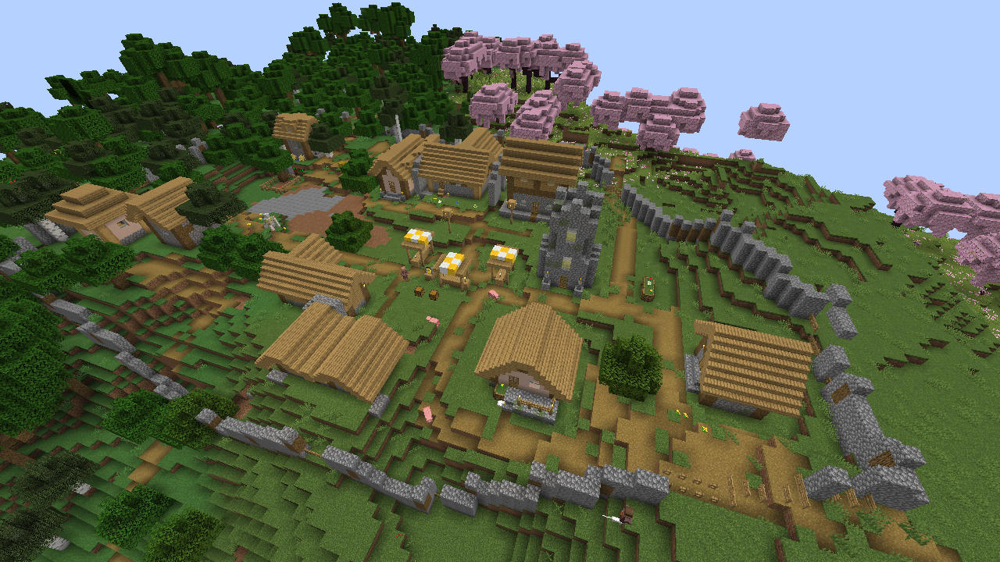
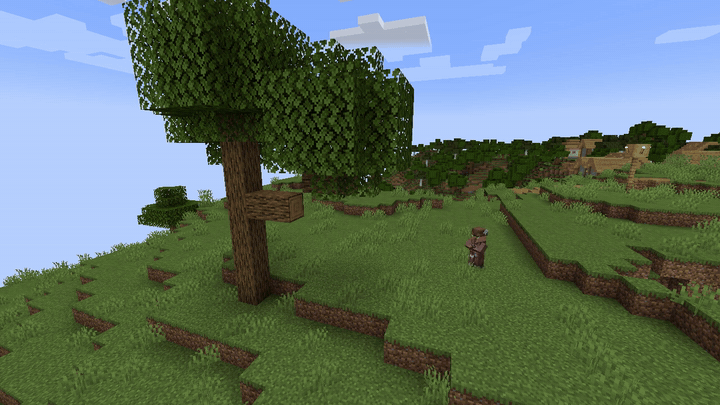
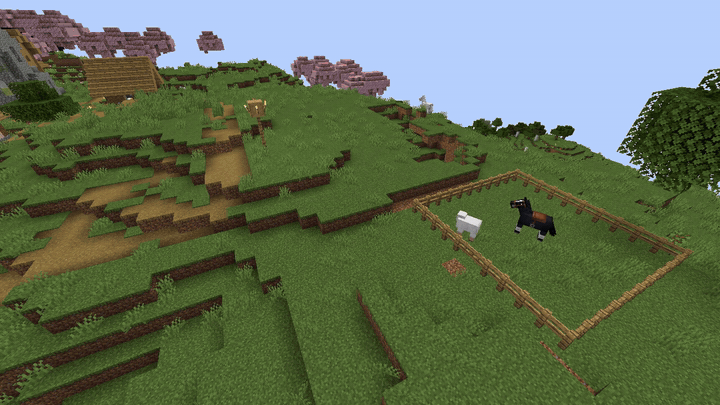
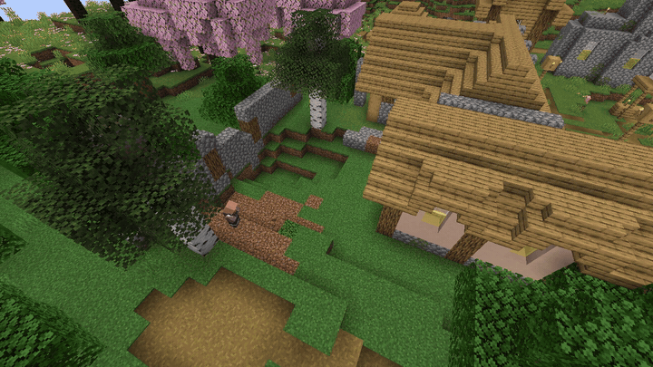
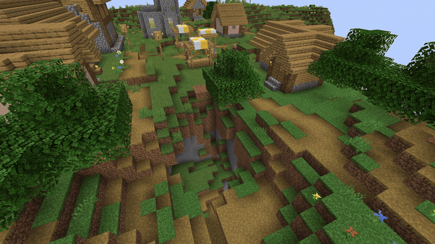
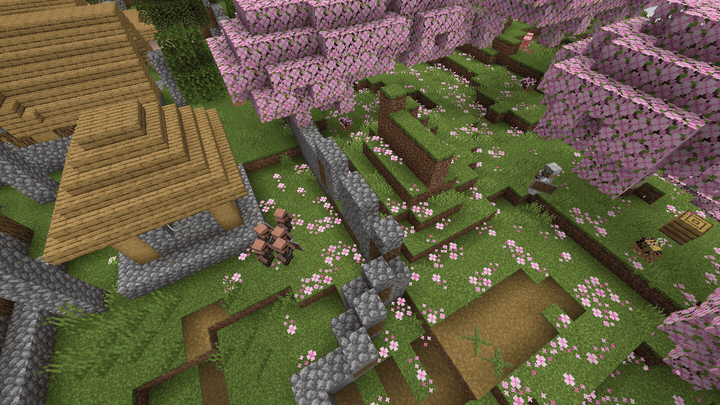

# Better Than Village

[![GitHub][github-badge]][github]
[![Discord][discord-badge]][discord]
![Modrinth: not published yet][modrinth-badge]
[![CurseForge][curseforge-badge]][curseforge]

[github-badge]: https://img.shields.io/badge/GitHub-Source-181717?style=for-the-badge&logo=github&logoColor=white
[github]: https://github.com/Vendetta1871/Better-Than-Village
[discord-badge]: https://img.shields.io/badge/Discord-Join-5865F2?style=for-the-badge&logo=data%3Aimage%2Fsvg%2Bxml%3Bbase64%2CPHN2ZyByb2xlPSJpbWciIHZpZXdCb3g9IjAgMCAyNCAyNCIgeG1sbnM9Imh0dHA6Ly93d3cudzMub3JnLzIwMDAvc3ZnIj48dGl0bGU%2BRGlzY29yZDwvdGl0bGU%2BPHBhdGggZmlsbD0id2hpdGUiIGQ9Ik0yMC4zMTcgNC4zNjk4YTE5Ljc5MTMgMTkuNzkxMyAwIDAwLTQuODg1MS0xLjUxNTIuMDc0MS4wNzQxIDAgMDAtLjA3ODUuMDM3MWMtLjIxMS4zNzUzLS40NDQ3Ljg2NDgtLjYwODMgMS4yNDk1LTEuODQ0Ny0uMjc2Mi0zLjY4LS4yNzYyLTUuNDg2OCAwLS4xNjM2LS4zOTMzLS40MDU4LS44NzQyLS42MTc3LTEuMjQ5NWEuMDc3LjA3NyAwIDAwLS4wNzg1LS4wMzcgMTkuNzM2MyAxOS43MzYzIDAgMDAtNC44ODUyIDEuNTE1LjA2OTkuMDY5OSAwIDAwLS4wMzIxLjAyNzdDLjUzMzQgOS4wNDU4LS4zMTkgMTMuNTc5OS4wOTkyIDE4LjA1NzhhLjA4MjQuMDgyNCAwIDAwLjAzMTIuMDU2MWMyLjA1MjggMS41MDc2IDQuMDQxMyAyLjQyMjggNS45OTI5IDMuMDI5NGEuMDc3Ny4wNzc3IDAgMDAuMDg0Mi0uMDI3NmMuNDYxNi0uNjMwNC44NzMxLTEuMjk1MiAxLjIyNi0xLjk5NDJhLjA3Ni4wNzYgMCAwMC0uMDQxNi0uMTA1N2MtLjY1MjgtLjI0NzYtMS4yNzQzLS41NDk1LTEuODcyMi0uODkyM2EuMDc3LjA3NyAwIDAxLS4wMDc2LS4xMjc3Yy4xMjU4LS4wOTQzLjI1MTctLjE5MjMuMzcxOC0uMjkxNGEuMDc0My4wNzQzIDAgMDEuMDc3Ni0uMDEwNWMzLjkyNzggMS43OTMzIDguMTggMS43OTMzIDEyLjA2MTQgMGEuMDczOS4wNzM5IDAgMDEuMDc4NS4wMDk1Yy4xMjAyLjA5OS4yNDYuMTk4MS4zNzI4LjI5MjRhLjA3Ny4wNzcgMCAwMS0uMDA2Ni4xMjc2IDEyLjI5ODYgMTIuMjk4NiAwIDAxLTEuODczLjg5MTQuMDc2Ni4wNzY2IDAgMDAtLjA0MDcuMTA2N2MuMzYwNC42OTguNzcxOSAxLjM2MjggMS4yMjUgMS45OTMyYS4wNzYuMDc2IDAgMDAuMDg0Mi4wMjg2YzEuOTYxLS42MDY3IDMuOTQ5NS0xLjUyMTkgNi4wMDIzLTMuMDI5NGEuMDc3LjA3NyAwIDAwLjAzMTMtLjA1NTJjLjUwMDQtNS4xNzctLjgzODItOS42NzM5LTMuNTQ4NS0xMy42NjA0YS4wNjEuMDYxIDAgMDAtLjAzMTItLjAyODZ6TTguMDIgMTUuMzMxMmMtMS4xODI1IDAtMi4xNTY5LTEuMDg1Ny0yLjE1NjktMi40MTkgMC0xLjMzMzIuOTU1NS0yLjQxODkgMi4xNTctMi40MTg5IDEuMjEwOCAwIDIuMTc1NyAxLjA5NTIgMi4xNTY4IDIuNDE5IDAgMS4zMzMyLS45NTU1IDIuNDE4OS0yLjE1NjkgMi40MTg5em03Ljk3NDggMGMtMS4xODI1IDAtMi4xNTY5LTEuMDg1Ny0yLjE1NjktMi40MTkgMC0xLjMzMzIuOTU1NC0yLjQxODkgMi4xNTY5LTIuNDE4OSAxLjIxMDggMCAyLjE3NTcgMS4wOTUyIDIuMTU2OCAyLjQxOSAwIDEuMzMzMi0uOTQ2IDIuNDE4OS0yLjE1NjggMi40MTg5WiIvPjwvc3ZnPg%3D%3D&logoColor=white
[discord]: https://discord.gg/gvmeswCQFP
[modrinth-badge]: https://img.shields.io/badge/Modrinth-Soon-555555?style=for-the-badge&logo=modrinth&logoColor=white
[curseforge-badge]: https://img.shields.io/badge/CurseForge-Download-F16436?style=for-the-badge&logo=data%3Aimage%2Fsvg%2Bxml%3Bbase64%2CPHN2ZyByb2xlPSJpbWciIHZpZXdCb3g9IjAgMCAyNCAyNCIgeG1sbnM9Imh0dHA6Ly93d3cudzMub3JnLzIwMDAvc3ZnIj48dGl0bGU%2BQ3Vyc2VGb3JnZTwvdGl0bGU%2BPHBhdGggZmlsbD0id2hpdGUiIGQ9Ik02LjMwNyA1LjU4MWwuMzkxIDEuNjc1SDBzLjExMi41MDIuMTY3LjU1OGMuMTY4LjI3OS4zMzUuNjE0LjU1OS44MzcgMS4wNiAxLjIyOCAyLjkwMiAxLjczIDQuNDA5IDIuMDA5IDEuMDYuMjI0IDIuMTIxLjI4IDMuMTgxLjMzNWwxLjIyOCAzLjI5M2guNjdsLjM5MSAxLjA2MWgtLjU1OGwtLjk0OSAzLjA3aDkuMzIxbC0uOTQ5LTMuMDdoLS41NThsLjM5LTEuMDYxaC42N3MuNTU4LTMuNDA0IDIuMjg4LTQuOTY3QzIxLjkzNSA3Ljc1OCAyNCA3LjUzNSAyNCA3LjUzNVY1LjU4MUg2LjMwN3ptOS4zNzcgOC40MjhjLS40NDcuMjc5LS45NDkuMjc5LTEuMjg0LjUwMy0uMjIzLjExMS0uMzM1LjQ0Ni0uMzM1LjQ0Ni0uMjIzLS41MDItLjUwMi0uNjctLjgzNy0uNzgxLS4zMzUtLjExMi0uOTQ5LS4wNTYtMS43ODYtLjc4Mi0uNTU4LS41MDItLjYxNC0xLjE3Mi0uNTU4LTEuNTA3di0uMTY3YzAtLjA1NiAwLS4xMTIuMDU2LS4xNjguMTExLS4zMzQuMzktLjY2OS45NDgtLjg5MyAwIDAtLjM5LjU1OSAwIDEuMTE3LjIyNC4zMzUuNjcuNTAyIDEuMDYxLjI3OS4xNjctLjExMi4yNzktLjMzNS4zMzUtLjUwMy4xMTEtLjM5LjExMS0uNzgxLS4yMjQtMS4wNi0uNTAyLS40NDYtLjYxMy0xLjA2LS4yNzktMS40NTEgMCAwIC4xMTIuNTAyLjYxNC40NDYuMzM1IDAgLjMzNS0uMTExLjIyNC0uMjIzLS4wNTYtLjE2Ny0uNzgyLTEuMjI4LjI3OS0yLjAwOSAwIDAgLjY2OS0uNDQ3IDEuNDUxLS4zOTEtLjQ0Ny4wNTYtLjk0OS4zMzUtMS4xMTYuNzgydi4wNTVjLS4xNjguNDQ3LS4wNTYuOTQ5LjI3OSAxLjM5Ni4yMjMuMzM1LjUwMi42MTQuNjE0IDEuMDYtLjE2OC0uMDU2LS4yNzkgMC0uMzkxLjExMmEuNTMzLjUzMyAwIDAwLS4xMTIuNTAyYy4wNTYuMTEyLjE2OC4yMjMuMjc5LjIyM2guMTY4Yy4xNjctLjA1NS4yNzktLjI3OS4yMjMtLjQ0Ni4xMTIuMTExLjE2Ny4zOTEuMTEyLjU1OCAwIC4xNjctLjExMi4zMzUtLjE2OC40NDYtLjA1Ni4xMTItLjE2Ny4yMjQtLjIyMy4zMzUtLjA1Ni4xMTItLjExMi4yMjQtLjExMi4zMzUgMCAuMTEyIDAgLjI3OS4wNTYuMzkxLjIyMy4zMzUuNjcgMCAuNzgyLS4yNzkuMTY3LS4zMzUuMTExLS43MjYtLjExMi0xLjA2MSAwIDAgLjM5MS4yMjQuNjcgMS4wMDUuMjIzLjY3LS4xNjggMS40NTEtLjYxNCAxLjczeiIvPjwvc3ZnPg%3D%3D&logoColor=white
[curseforge]: https://www.curseforge.com/minecraft/mc-mods/better-than-village

<!-- MEDIA hero (demo/hero.txt): the village from above, its wall along the outermost houses -->


NeoForge 1.21.1 mod that turns vanilla villages into small medieval societies. Villagers really doing their jobs, interact with environment (break and build blocks, catch and breed animals, grow trees and mine ores) and each other (trade and pay taxes, wage war and conquer each other). The player can interact with them, but never join a country.

No new blocks, items, GUIs or entities: everything goes through vanilla assets.

Started as a clean-room implementation of the Independent Villagers mod - it is still available on the 
`legacy` branch.

## What villages do

### Villagers work

<!-- MEDIA lumberjack (demo/lumberjack.txt): a lumberjack fells a tree log by log and replants it -->


Lumberjacks fell trees and plant saplings in their place, miners dig a mine, farmers till, sow and harvest the fields.

<!-- MEDIA herder (demo/herder.txt): the herder lures sheep into the pen with wheat and breeds them -->


The herder lures animals, breeds the ones it has penned, shears the sheep and milks the cows for the village stock.

### A village is an economy

Each villager keeps a household. Farmers, miners and carpenters sell what they made. The elder collects taxes and
pays wages for public work. A child is born only  when its parents can pay for its house.

### Villages build themselves

<!-- MEDIA building (demo/building.txt): a mason finishing a house block by block -->


Masons build new houses and walls with materials the village gathered. A village that runs out of land will found a daughter village.

<!-- MEDIA pit (demo/pit.txt): the miner closes a deep pit among the houses from its edge inward -->


The village keeps its ground in order: miners close pits and dig a way into houses nobody can walk into.

### Land is property

The elder sells plots and empty houses, so a player can't build without his permission.

### The village has laws

Drawn weapons, building on village land, theft, killing livestock and hitting villagers are offences, seen by witnesses and remembered. A white flag in hand stops the fighting.

### Healers cure zombie villagers

Healer cures zombie villagers. Warriors fight it only when there is no healer or no cure.

### Countries go to war

<!-- MEDIA siege (demo/siege.txt): five against five, a rider among the attackers, no golems -->


Countries trade by caravan, buy border land from each other, quarrel and make war. A conquered village joins the winner; long wars wear countries down until they sue for peace.

> **Work in progress:** the fighting itself (how soldiers and defenders close in, strike and fall)
> is not finished yet and looks rough.

At night, countries send thieves, arsonists and assassins to their enemies. A player who grows
too strong becomes a target too: neighbours form coalitions, find the player's base and raid it,
even while the player is away.

### The world lives on while nobody watches

Villages far from any player keep living through ledgers. When a player comes back, the village has the houses, people and walls it earned in the meantime.

## Documentation

- `docs_v2/`: the design. See the [overview and glossary](https://github.com/Vendetta1871/Better-Than-Village/blob/main/docs_v2/README.md) and the
  [roadmap](https://github.com/Vendetta1871/Better-Than-Village/blob/main/docs_v2/01-roadmap.md); there are documents for professions, economy, land, law,
  politics, warfare and the abstract simulation. Each document ends with implementation notes.
- `docs/dev/ARCHITECTURE.md`: packages, tick flow and an API cheat sheet.
- `tests/`: headless server scenarios and their runner ([how to run](https://github.com/Vendetta1871/Better-Than-Village/blob/main/tests/README.md)).
- `demo/`: the staged scenes the pictures above come from, replayed by the dev client
  ([how to run](https://github.com/Vendetta1871/Better-Than-Village/blob/main/demo/README.md)).

Every subsystem has a section with an `enabled` switch in `config/better_than_village.json`
(created on first start).

## Build

Requires JDK 21.

```sh
./gradlew build   # jar in build/libs/
```

## Commands

All commands are for operators (permission level 2) and mostly serve debugging and tests; run
them at or near a village (`execute positioned <x> <y> <z> run btv …` from the console).

- `/btv status`, `/btv villagers`, `/btv offers`: colony dump, villager AI states, trade offers.
- `/btv jobs`, `/btv repair`, `/btv house <biome> [template] [floor]`: construction.
  `/btv path <pos>`: can the village walk there, and what is in the way.
- `/btv land [sell | illegal | grow <blocks>]`: territory and domain map, deed sales.
- `/btv country [list | join | secede | loyalty | order | relation | war | peace | border | day]`:
  countries and diplomacy.
- `/btv world [step | caravan | stock | ledger]`: the abstract world.
- `/btv war [launch | step | fortify | ring | unwall | army | recruit | horses | golems | garrison | night | intel | offensive | player]`:
  campaigns, armies, night operations and war on the player.
- `/btv law …`, `/btv bot …`: law debugging and fake-player test bots.
- `/btv film …`: staged-demo tools. Use on a world copy.

## License

Released under the [GNU General Public License v3.0](https://github.com/Vendetta1871/Better-Than-Village/blob/main/LICENSE) (GPL-3.0-only).
